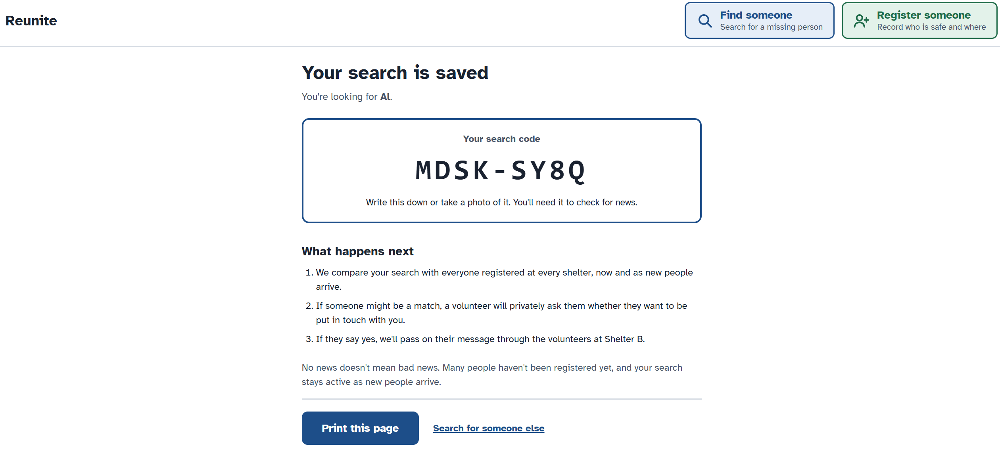
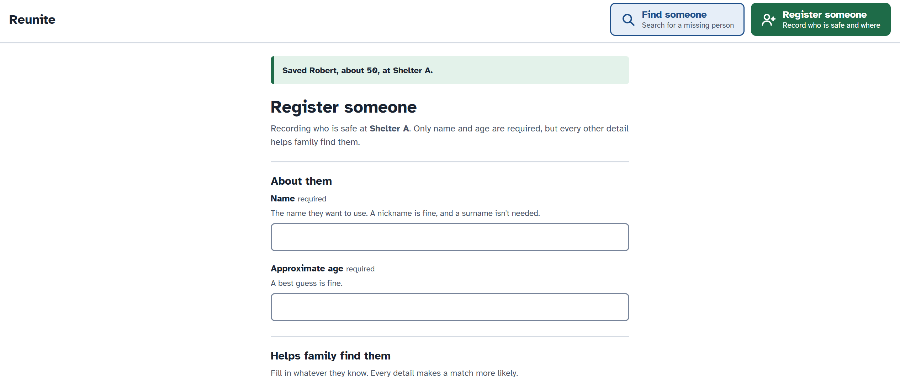

Live deployed link: https://dali-application-burns.onrender.com

HOW TO USE:
     - A username and password is needed to access the registration page of the site. I have created
       a sample volunteer profile for the purpose of reviewing this site:
         Username: admin-test
         Password: DALI_APPLICATION
       Once logged in, you can view the admin page of this site at https://dali-application-burns.onrender.com/admin. 
       This displays everything in the database (registered people, searches, matches, shelters, etc). 
        
Overview: This site implements a system to easily register people who have been displaced from their homes,
          while also allowing anyone to search for people in the database. Registration is mainly through 
          shelters (volunteers have their own login associated with a certain shelter for simple record-tracking),
          although individuals can register themselves through a different form if they have access to the Internet 
          and are not at a shelter. All searches are manually reviewed - the database is initially searched for matches
          in name, but all searches are are reviewed to ensure that false matches are minimized. There may be many people
          with the same name, from similar areas, and who are even searching for similarly named people, so the best way to
          ensure that we don't have false search results is to have volunteers speak with the people who appeared in the search
          result to see if they are the correct person, and to see if they actually want to be found. Although this approach
          puts far more labor on the volunteers, it is essential for the safety and privacy of people.

Example: There is currently one registered person in the database (name: Alex Burns, age: 20, ...). You can view this entry
         by going to the admin page of the site and clicking on "Person records". Play with the search functionality by searching
         for exact name matches, similar name matches, simlar age, etc, and then check the "Matches" database section of the admin
         page to see the results of each search. You can also register a new person of your choosing (once logged in, see above) and
         explore the search functionality for your new registered person.

Screenshots: 
 - The results of the search page. Gives the searcher the necessary information to follow up with the search in the future (reference code)
 - Screen shown upon submitting the registration. Note that the site redirects the user back to the site, since the
                  volunteer is likely registering multiple people at once, so this redirect system saves the volunteer valuable time.

HELPFUL TOOLS PAGE:
    This page is split into a volunteer-focused section and a normal person-focused section. 
    Normal people
    - Register yourself: To ensure that all records are traceable and as accurate as possible, 
      only volunteers can register individuals when they show up at a shelter. However, this form 
      serves as a way that individuals can register themselves. This would be a different form that 
      doesn't require a login, but all entries would have to be approved by 
    - View a Shelter Map: This would allow people to visualize where they are (since evacuations are 
      so quick and chaotic that many people don't know where exactly they ended up), and would also 
      allow searchers to visualize where people have travelled, if they have moved between multiple 
      shelters. Shelters should have a collection of printed out maps as well for their residents to use
      so this map would serve as a up-to-date map that shelters can always print out. The location field
      in the shelter model currently does not a standardized form, so for this feature to be best implemented,
      that location field should be switched to an exact location, using GeoDjango or another geographcial
      library to allow users to input coordinates, addresses, or other exact coordinates that can be easily
      parsed by this map interface to display the exact location of each shelter.
    Volunteers
     - Edit/delete/check out residents. Although volunteers can easily access all records through
       the admin page, the only way to access that site is to type in the URL, since there are no links
       to the admin page directly on the site. Therefore, these options will provide volunteers with an easy
       way to make changes to any existing records in the database. 

AI Use:
    Much of the code on this project was initially written by AI (primarily Claude chatbot, not Claude Code), 
    and then modified to meet the 